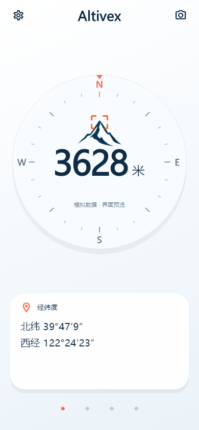
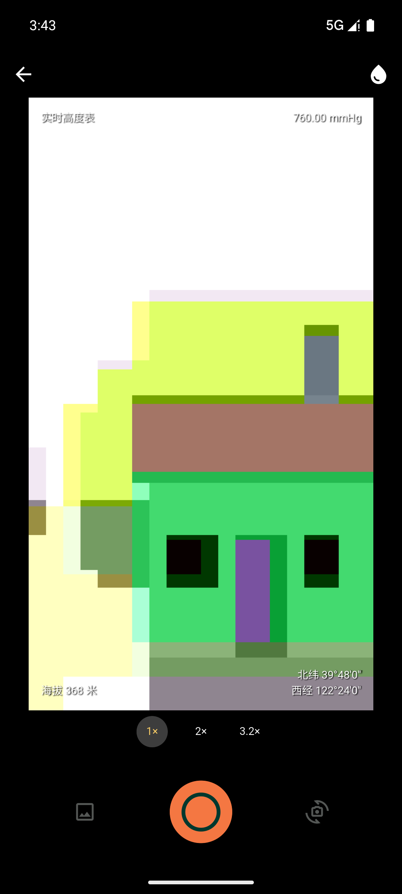

# Altivex

Altivex 是一款基于 Flutter 与 Dart 的移动端高度计与水印相机，面向 Android 和 iOS。通过设备定位、气压计和指南针显示测量信息，并将拍摄时的海拔、位置与时间写入照片。

## 界面预览

| 高度计 | 水印相机 |
| --- | --- |
|  |  |

高度计截图使用模拟数据；相机截图来自 Android 模拟器，包含虚拟场景。截图不代表真机测量精度。

## 主要功能

- **高度测量**：显示定位高度或气压估算高度，支持米与英尺；显示测高来源与 GPS 垂直精度。
- **界面设置**：浅色与深色主题、系统照片选择器自定义背景，支持海拔单位、坐标格式及气压单位持久化。
- **信息卡片**：左右滑动查看经纬度、气压、本地计算的日出日落及定位与测高状态。
- **气压校准**：显示大气压力，使用符合精度与时效条件的 GPS 数据自动校准，也可手动重新校准。
- **位置与方向**：显示经纬度与完整四向指南针。主界面固定竖屏，手机物理朝向变化时指南针仍实时更新。
- **水印相机**：拍摄时冻结测量快照，提供经典四角、底部信息栏、极简海拔和专业仪表四套水印，支持关闭水印。
- **拍摄控制**：前后镜头切换、闪光灯、设备支持的变焦、点击对焦与曝光调整，以及九宫格、水平仪和定时拍摄。
- **照片管理**：支持 JPEG / PNG、4:3 / 16:9 / 1:1 比例、手动或自动保存、持久拍摄记录、缩放查看和系统分享。
- **数据状态提示**：权限不足、传感器缺失或数据过期时显示不可用状态；模拟模式需在设置中主动开启。

相机设置与拍摄记录保存在应用内部。删除拍摄记录时默认保留系统相册副本；Android 可选择同时删除对应副本。辅助线不写入照片。

主界面、设置面板和照片历史列表仅使用竖屏；水印相机和单张照片预览支持横竖屏，返回时恢复对应页面的方向。iPad 使用全屏模式；Android 部分大屏设备受系统方向锁定限制，主界面仍保持纵向布局。

## 测量说明

真实测量依赖设备能力和授权，无数据时不会用模拟数值填充。定位数据超过 30 秒、气压或方向数据超过 10 秒未更新后，不再作为当前测量使用。

气压高度使用 `44330 × (1 - (P/P0)^0.1903)` 计算。未校准时以 1013.25 hPa 为参考并标注状态；GPS 数据新鲜且水平、垂直精度均在 30 米内时可校准。校准仅在本次运行中保留，精度门槛不代表实际测量误差保证。

GPS 高度基准由系统定位服务提供，尚未统一进行大地水准面修正；气压高度受天气和参考高度误差影响。GPS 垂直精度不能直接视为气压高度的实际误差。应用仅使用前台定位，核心测量不依赖互联网，首次定位仍可能较慢。

## 开发

需要与 `pubspec.yaml` 兼容的 Flutter SDK，以及目标平台的开发工具。Android 需要 Android SDK；iOS 需要 macOS 和 Xcode。

```sh
flutter pub get
flutter analyze
flutter test
flutter devices
flutter run -d <device-id>
```

构建 Android 安装包：

```sh
flutter build apk --release
```

标准输出目录为 `build/app/outputs/flutter-apk/`。当前 Release 构建使用开发调试证书，仅用于安装测试；正式分发前需配置应用标识和生产签名。依赖锁文件 `pubspec.lock` 纳入版本控制，以保持应用依赖可复现；构建产物、日志和设备数据不纳入仓库。

## 项目结构

| 目录或模块 | 职责 |
| --- | --- |
| `lib/altimeter_reading.dart` | 测量快照、单位与坐标格式、数学函数 |
| `lib/measurement_hardware.dart` | 设备能力及跨平台传感器适配 |
| `lib/altimeter_controller.dart` | 权限、订阅、数据时效、平滑与校准 |
| `lib/altimeter_page.dart` | 高度计界面与设置 |
| `lib/photo_preview_page.dart` | 相机生命周期与拍摄流程 |
| `lib/photo_watermark.dart` | 取景水印与成片水印绘制 |
| `lib/photo_store.dart` | 拍摄记录与相机设置持久化 |
| `android/app/src/main/kotlin/` | Android 图片合成及相册适配 |
| `assets/branding/` | Logo 源图、导出资源及图标生成工具 |
| `test/` | 测量逻辑、相机交互、存储与水印测试 |

## 平台与验证

Android JPEG 使用原生图片合成路径，PNG 和其他平台使用跨平台处理路径。输出尺寸取决于相机能力与所选裁切比例。应用不扫描系统相册；旧版 Android 保存照片时可能需要存储权限。

iOS 部署目标为 iOS 15，已配置权限用途说明；iOS 构建与真机行为尚未完成验证，指定相册副本删除暂不支持。

- [版本变更](CHANGELOG.md)
- [相机真机测试清单](docs/相机真机测试清单.md)
- [拍摄性能测量记录](docs/拍摄性能排查记录.md)
